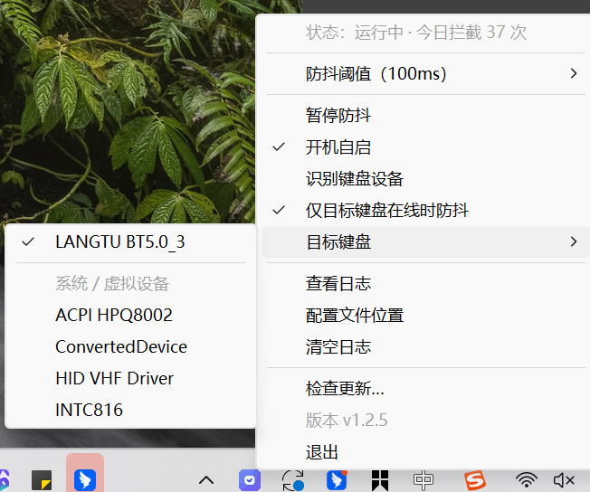

# 防止某键盘误触发


新买的键盘用了几个月，一个问题越来越明显，就是误触发，按一次，重复响应多次，随时随地敲错特别烦。

就算我按得再轻也没用。

这个问题用 win 自带的 筛选键功能无法解决。

然而键盘超出了包退期，要自己花运费寄过去修QAQ！

所以我写了这个小程序，屏蔽重复触发。

希望能帮到不小心买到类似键盘的你。

## 来源与致谢

本项目源自 [garfeng/keyboard](https://github.com/garfeng/keyboard)（MIT 协议）：原作者用 C++ 实现了最初的版本。本仓库在其基础上先用 Go 重写了全部代码，并增加了拦截日志、设备识别与目标键盘、开机自启、托盘/菜单栏界面以及 macOS 支持；2026 年 11 月起改用 Rust 实现（见「更新记录」）。

解压后，双击里面的 keyboard-plus.exe 运行。

托盘图标右键可以设置防抖阈值、暂停拦截、开机自启、识别键盘设备、选择目标键盘、切换图标样式（标准版）、查看/清空日志、定位配置文件。暂停时托盘图标会由绿色切换为珊瑚色，菜单第一行也会显示当前状态。开启「开机自启」后就不需要每次手动双击了。



macOS 版本下载后直接运行 `keyboard-plus`，图标出现在菜单栏。首次运行需要在「系统设置 → 隐私与安全性 → 输入监控」中勾选本程序（听不到按键时请看这一项），之后重新启动即可生效。菜单里同样可以设置防抖阈值、暂停拦截、开机自启、切换图标样式（标准版）、打开日志与配置文件；macOS 目前只做全局拦截，没有「目标键盘」相关选项。程序未做代码签名，若提示「无法打开」，在「隐私与安全性」里点「仍要打开」即可。

> macOS 版本尚未在真机上验证，可能存在未知问题，详见下文「平台支持」。

下载地址：https://github.com/singcl/keyboard/releases/latest

## 功能支持

| 功能 | Windows | macOS |
| --- | --- | --- |
| 全局防抖拦截（同一颗键在阈值内重复按下即丢弃） | ✓ 低级键盘钩子 | ✓ CGEventTap |
| 预设阈值 100 / 80 / 67 / 50ms | ✓ | ✓ |
| 自定义阈值（10–1000ms） | ✓ | ✓ |
| 暂停 / 恢复（图标切换珊瑚色） | ✓ | ✓ |
| 托盘图标样式（键盘板 / 脉冲屏） | ✓ 标准版 | ✓ 标准版 |
| 状态行显示运行状态与今日拦截次数 | ✓ | ✓ |
| 开机自启 | ✓ 注册表 Run 键 | ✓ LaunchAgent |
| 查看拦截日志 | ✓ 内置窗口，自动刷新、可清空 | 用系统默认程序打开日志文件 |
| 定位配置文件 | ✓ 资源管理器 | ✓ Finder |
| 检查更新（启动时静默检查 + 菜单手动检查，仅标准版） | ✓ | ✓ |
| 识别键盘设备 | ✓ | — |
| 目标键盘 / 仅目标键盘在线时防抖 | ✓ | — |
| 单实例（重复启动时提示） | ✓ | ✓ |
| 系统要求 | Windows 10+（x64） | macOS 10.15+（Apple Silicon / Intel） |

说明：拦截本身在所有平台上都是**全局**的，macOS 不提供设备识别与目标键盘，因此也没有「仅目标键盘在线时防抖」。日志与配置路径见下文。

程序启动时会静默检查一次 GitHub 上的最新版本，只有发现新版本才提示；也可以随时在菜单里点「检查更新…」。出于安全考虑，更新只提示并打开下载页面，不会自动下载或替换程序。

### 两个版本

每个平台的 Release 都提供两个压缩包：

| 版本 | 文件名 | 说明 |
| --- | --- | --- |
| 标准版 | `keyboard-plus-windows-amd64.zip`、`keyboard-plus-macos-universal.zip` | 含「检查更新」，启动时会访问 `api.github.com` |
| 精简版 | 文件名带 `-slim` | 去掉联网检查与图标样式切换（不链接任何 HTTP/TLS 代码，也不内嵌第二套图标），体积约为标准版的四分之一，不访问网络；其余功能完全一致 |

两个版本的配置、日志与开机自启共用，同时安装时也只会运行一个实例；想彻底断网使用就选精简版。

## 构建

需要 Rust 1.85+（edition 2024）。Windows 侧还需 MSVC 工具链（Visual Studio Build Tools + Windows SDK），即 `rustup` 默认安装的 `x86_64-pc-windows-msvc` 目标；无其他第三方构建依赖。

```
build.bat      # Windows cmd / PowerShell
./build.sh     # Git Bash / WSL
```

或手动执行：

```
cargo build --release
```

两个脚本会同时产出标准版 `keyboard-plus.exe` 与精简版 `keyboard-plus-slim.exe`；`windows_subsystem` 属性保证运行时不显示控制台窗口。

精简版用 `--no-default-features` 编译（去掉「检查更新」，不链接任何 HTTP/TLS 代码，体积约为标准版的四分之一）：

```
cargo build --release --no-default-features
```

## Git 代理

项目内提供了配置和取消 Git 代理的脚本，只影响当前仓库，不会修改全局配置。

Windows：

```
git-proxy.bat set                       # 使用默认代理 http://127.0.0.1:10808
git-proxy.bat set http://127.0.0.1:7890 # 指定代理
git-proxy.bat unset                     # 取消代理
```

Shell（Git Bash / macOS / Linux）：

```
./git-proxy.sh set
./git-proxy.sh set http://127.0.0.1:7890
./git-proxy.sh unset
```

图标、清单与版本信息由 `build.rs` 组装成 RC 资源后编译进 exe（版本号取 `KEYBOARD_PLUS_VERSION` 环境变量，缺省用 `Cargo.toml` 的版本）；修改 `assets/` 下的资源无需额外步骤，重新 `cargo build` 即可。

macOS 版本沿用 Objective-C / C 实现的菜单栏与事件监听（`native/macos/`），由 `cc` 在构建时一并编译，需要 Xcode 命令行工具：

```
cargo build --release --bins
```

同时支持 Apple Silicon 与 Intel 的通用二进制：

```
rustup target add aarch64-apple-darwin x86_64-apple-darwin
for target in aarch64-apple-darwin x86_64-apple-darwin; do
  cargo build --release --target $target --bins
done
lipo -create -output keyboard-plus \
  target/aarch64-apple-darwin/release/keyboard-plus \
  target/x86_64-apple-darwin/release/keyboard-plus
```

精简版同样加 `--no-default-features`。

## 项目结构

```
.
├── assets/                    # 图标与清单；icon.png 编入程序，其余经 build.rs 编进资源
├── native/macos/              # macOS 的 Objective-C / C 实现（菜单栏、CGEventTap）
├── src/
│   ├── main.rs                # 平台入口分发
│   ├── tray/                  # Windows 界面：托盘图标、菜单、阈值对话框、日志窗口
│   ├── macos/                 # macOS 入口：与 native/macos 的 FFI 桥接
│   ├── hook/                  # 键盘拦截（WH_KEYBOARD_LL / CGEventTap）与判重逻辑
│   ├── devices/               # 键盘设备识别（Raw Input）与分组展示
│   ├── logging/               # 拦截日志（异步写入、轮转、清空）
│   ├── autostart/             # 开机自启（注册表 Run 键 / LaunchAgent）
│   ├── singleinstance.rs      # 单实例（互斥量 / 文件锁）
│   ├── config.rs              # 配置持久化（防抖阈值、目标键盘）
│   ├── update.rs              # 检查更新（标准版）；精简版编译为空实现
│   ├── stats.rs               # 今日拦截计数（跨天自动清零）
│   └── timeutil.rs            # 本地时间格式化（日志时间戳、跨天判断）
├── build.rs                   # 版本注入、Windows 资源编译、macOS 原生源码编译
├── .github/workflows/build.yml # CI：Windows / macOS 构建与发布
├── build.bat / build.sh       # 本地构建脚本
├── Cargo.toml
└── README.md
```

## 拦截日志

被拦截的按键记录在 `%LOCALAPPDATA%\keyboard-plus\keyboard-plus.log`（macOS 为 `~/Library/Caches/keyboard-plus/keyboard-plus.log`），托盘右键「查看日志」会在内置窗口里显示最后 500 行并每 2 秒自动刷新，「清空日志」可删除；「配置文件位置」会在资源管理器中定位 `config.json`。

注意：日志包含被拦截按键的名称和键码，属于输入信息，分享或反馈问题前请先清空或自行删改。

## 按键盘设备过滤

托盘菜单「识别键盘设备」会列出当前系统的键盘设备（品牌、VID/PID、设备路径），方便你确认是哪一把键盘有问题。部分键盘的 VID/PID 是公版或套用的，此时以设备名（如 `LANGTU BT5.0_3`）或设备路径为准。

「目标键盘」子菜单可以选定要关注的键盘（按设备路径精确匹配，重启后保留；名称重复的设备会追加 VID/PID 以便区分），每次右键打开菜单时会自动刷新设备列表；勾选「仅目标键盘在线时防抖」后，只有该键盘连接时才会启用拦截，拔掉或未连接时自动暂停，其他键盘单独使用时不受影响。注意路径与 USB 接口绑定，换到另一个接口后需要重新选择目标。

当前是否在拦截可以直接看托盘菜单第一行的状态（运行中 / 已暂停 / 已暂停（目标键盘未连接）），悬停图标也会显示；目标键盘上下线、自动暂停/恢复都会写入日志，便于事后核对。

但拦截本身仍是**对所有键盘生效**的：Windows 的低级键盘钩子（`WH_KEYBOARD_LL`）回调里没有设备标识，纯用户态程序无法判断按键来自哪把键盘。若确实需要只对指定设备生效，只能安装内核过滤驱动（如 Interception），代价是需要管理员权限、驱动签名，并会失去免安装单文件的分发方式。

## 平台支持

目前支持 Windows 与 macOS，其他平台（如 Linux）不在支持计划内。

> **macOS 版本尚未经过真机验证。** 开发者没有 macOS 设备，macOS 相关代码只通过了 CI 编译和单元测试，拦截效果、权限授权流程、菜单行为都未在真机上完整验证过，可能存在未知问题。如果你在 macOS 上使用，欢迎把结果或问题反馈到 [Issues](https://github.com/singcl/keyboard/issues)。

macOS 版本使用 `CGEventTap` 做主键拦截，系统版本要求 macOS 10.15+：

* 首次运行会请求「输入监控」权限，授权后需要重新启动程序；菜单第一行显示「未生效（缺少权限）」时说明没有授权。
* 与 Windows 一样，事件回调里拿不到设备标识，因此只有全局拦截，没有「目标键盘 / 仅目标键盘在线时防抖」选项。
* 开机自启写入 `~/Library/LaunchAgents/com.singcl.keyboard-plus.plist`，下次登录时生效；取消勾选会删除该文件。
* 日志与配置文件位于 `~/Library/Caches/keyboard-plus/`。

平台相关代码（键盘钩子、开机自启、单实例、按键名解析）都按 `windows.rs` / `macos.rs` / `stub.rs` 拆分，Windows 部分只依赖 `windows` crate；macOS 的界面与事件监听沿用 Objective-C / C，经 FFI 调用。

## 更新记录

* 2026年11月：新增托盘图标样式切换（键盘板 / 脉冲屏，标准版功能）；精简版固定使用键盘板

* 2026年11月：全新品牌图标（绿色键盘板）；暂停时托盘图标切换为珊瑚色，Windows 与 macOS 表现一致

* 2026年11月：改用 Rust 重写全部代码（Windows 界面不再依赖 walk，改为直接调用 Win32 API；macOS 的 Objective-C / C 实现保留）。配置、日志与开机自启的存储位置和格式不变，老用户升级无需重新设置

* 2026年11月：新增「检查更新」（标准版），并提供不含联网检查的精简版（`-slim`）

* 2026年11月：程序改名为 keyboard-plus（原 keyboard.exe 与原项目重名），配置、日志与开机自启设置保持不变

* 2026年11月：新增 macOS 版本：菜单栏图标、CGEventTap 全局拦截、LaunchAgent 开机自启

* 2026年11月：平台相关模块按构建标签拆分，非 Windows 平台提供占位实现，为后续移植预留接口

* 2026年11月：暂停时图标变灰，新增内置日志窗口与「配置文件位置」，加入 GitHub Actions 自动构建与发布

* 2026年11月：新增目标键盘选择与「仅目标键盘在线时防抖」，修复自动暂停不生效的问题

* 2026年11月：新增设备识别、配置持久化、开机自启、暂停防抖、日志清理

* 2026年11月：纯 Go 重写，新增拦截日志与内嵌图标

* 2022年9月28日：加系统托盘图标

* 2018年6月：基本功能完成